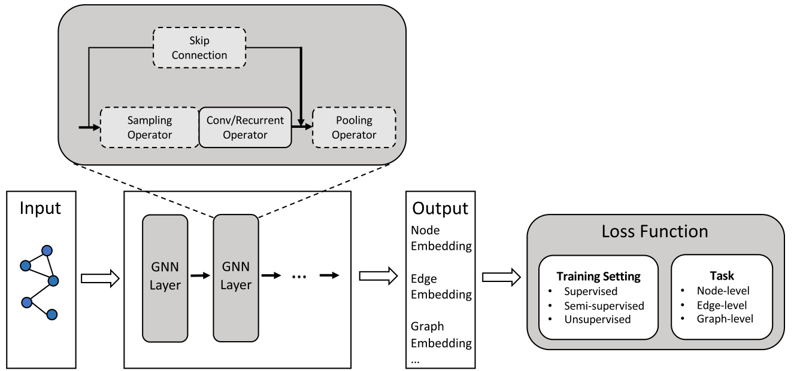
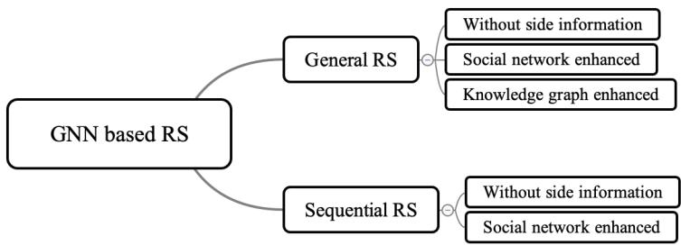
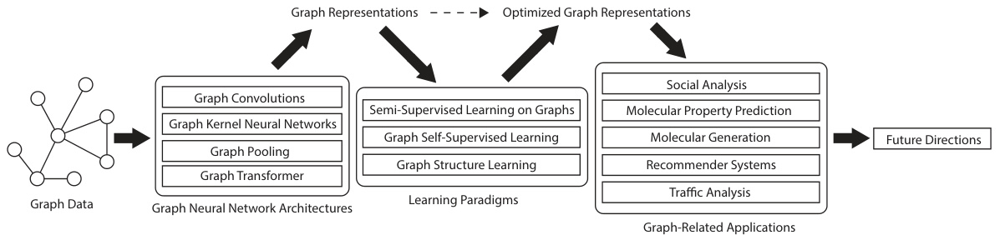

# 三张示例图：怎么读、怎么借

这三张图由用户提供，只作**结构示例**，不是可直接复用的素材。原图版权归原作者/出版方；若要在论文中复用，需核对原文许可，或按同样的逻辑重绘并引用原文。图中的 venue、年份与图号沿用原笔记，正式引用前请核对出版信息。

## 1. 通用设计流水线（按原笔记：AI Open 2020, Fig.2）

**它承担的角色**：通用框架图，也是全篇的分类坐标系。它不是「GNN 长什么样」的插图，而是把所有方法拆到同一条流水线上。

**读图顺序**：

1. 左侧 `Input`：图数据；
2. 中间 `GNN Layer`：采样算子（Sampling Operator）→ 卷积/循环算子（Conv/Recurrent Operator）→ 池化算子（Pooling Operator），外层还有跳连（Skip Connection）；
3. 右侧 `Output`：节点嵌入、边嵌入、图嵌入；
4. 最右 `Loss Function`：训练设置（监督/半监督/无监督）× 任务层级（节点/边/图）。

**可偷师**：把「方法列表」变成「阶段 × 算子 × 训练设置 × 任务」的组合。每个方法不再是一个名字，而是流水线上的一个配置。这样 taxonomy 天然可扩展：新方法出现时，读者知道该把它放在哪一段。

**写自己的图**：先定 4–6 个阶段，再给每个阶段列 2–4 个设计选项；不要把所有方法名塞进一张图。图里只放**类别和机制**，具体方法放正文和对比表。

## 2. Taxonomy 总图（按原笔记：CSUR 2023, Fig.5）

**它承担的角色**：taxonomy 总图，一图公示全篇结构。读者和审稿人靠它导航。

**读图顺序**：

1. 顶层按任务分为 `General RS` 与 `Sequential RS`；
2. 第二层按信息类型展开：`Without side information`、`Social network enhanced`、`Knowledge graph enhanced`（图中 Sequential RS 只画到前两类）；
3. 每个叶子对应正文的一节，节内再给代表作与对比表。

**可偷师**：这张图是**层级树**，不是矩阵。它用「任务 × 信息类型」两个维度，但没有强行画满所有交叉格。双维不一定要画成网格；层级展开同样能表达双维，而且更适合类别不均衡的领域。空白格（例如图中未展开的组合）要先验证是真空白，再写成未来方向。

**写自己的图**：先确定顶层维度，再决定第二层；如果第二层只对某些顶层类别成立，就在图上留白并说明，不要为了对称硬造类别。

## 3. 本文结构图（按原笔记：Neural Networks 2024, Fig.1）

**它承担的角色**：本文结构图，展示综述自己的 architecture。它不只是目录，而是把全文的论证链画出来。

**读图顺序**：

1. `Graph Data`：输入对象；
2. `Graph Neural Network Architectures`：图卷积、图核神经网络、图池化、图 Transformer；
3. `Learning Paradigms`：图上半监督学习、图自监督学习、图结构学习；
4. `Graph-Related Applications`：社交分析、分子性质预测、分子生成、推荐系统、交通分析；
5. `Future Directions`：开放挑战与未来方向。

图的上方还有 `Graph Representations → Optimized Graph Representations` 的表示流，说明架构与学习范式共同作用于表示，再进入应用。

**可偷师**：结构图要画出「数据 → 方法 → 学习范式 → 应用 → 未来」的因果/叙事顺序，而不是把目录原样搬成方框。读者看完这张图，应该能复述你的核心论点。

**写自己的图**：先写一句「本文的叙事链是 ___ → ___ → ___」，再画方框；如果画出来只是五节标题，说明还没有结构图，只有目录。

## 三张图连起来看

| 图 | 回答的问题 | 在你的综述里对应 |
|---|---|---|
| 通用设计流水线 | 方法内部由哪些阶段组成？ | 分类坐标系 / 主体开头的框架图 |
| Taxonomy 总图 | 整个领域怎么分？ | 主体开头的分类总图 |
| 本文结构图 | 这篇综述怎么讲？ | 引言里的全文路线图 |

三张图的功能不同，不要互相替代，也不要为了凑图重复画同一张地图。中等篇幅的综述通常 6–10 张图：一张结构图、一张 taxonomy 总图、一张通用框架图、每类一张框架图，再按需补领域直觉图。

## 图注写法

每张图的 caption 写结论，不写标签：

- 差：「GNN 通用框架图。」
- 好：「所有 GNN 方法都可拆为采样、卷积/循环、池化三个阶段；现有工作主要集中在卷积算子，池化与跳连的设计仍缺少统一评价。」

图下方再给一句读法：先看哪一侧、箭头/颜色表示什么、虚线框表示什么。保证黑白打印仍可读。

## 复用提醒

- 这三张图是**别人的图**，不是你的贡献；直接放进论文可能涉及版权。
- 最稳妥的做法：借鉴结构，重绘为自己的领域版本，并在 caption 或正文注明「改编自 ___」。
- 如果只是内部学习/组会讲解，保留出处即可；投稿前按目标 venue 的版权政策处理。
